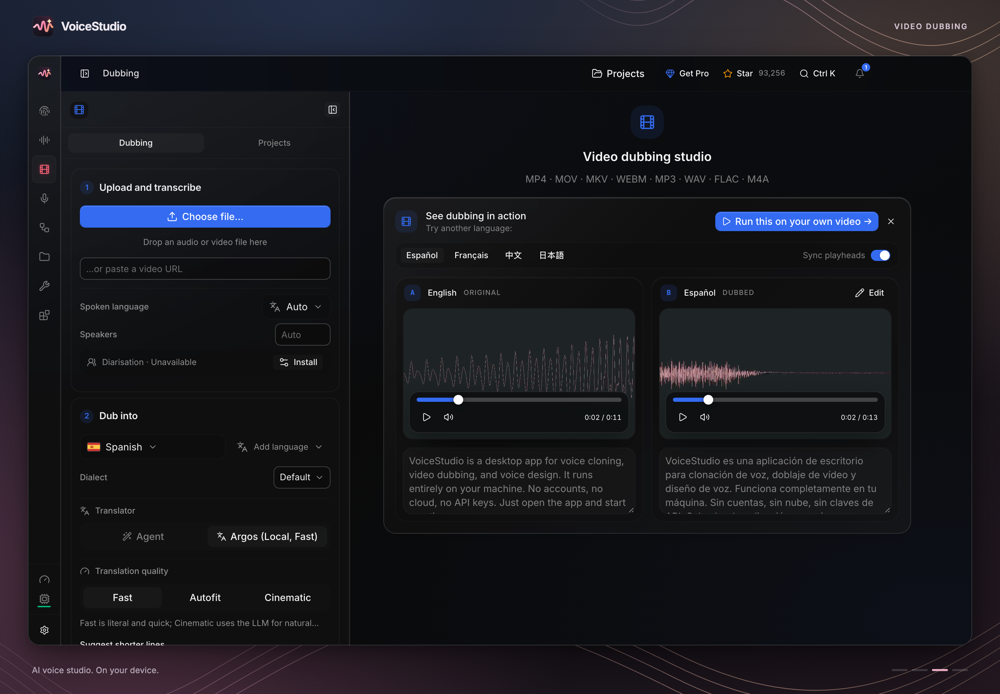

# Electron dubbing workspace

## Prepare media and subtitles before starting

Local-file preparation offers **Keep music and ambience**, initially on (as
before) and remembered for later uploads. Choosing voice only skips both Demucs
and its HQ stereo extraction;
the dub replaces the original voice without a background bed. API callers that
omit `separate_background` keep the existing separation default. Cache identity
includes the separation choice so stems cannot leak between modes. URL ingest
keeps its existing behavior. Existing prepared projects are not reprocessed.

The source card guides local preparation through file selection, SRT choice,
SRT language (source or target), optional background separation, script style,
and a final summary. Selecting files does not start ASR, separation or TTS.
SRTs are validated before media upload. Failed/rejected preparation retains the
selected files and current question in the same window; a confirmed handoff or
Clear consumes them. A reload requires selecting local files again.

An SRT declared in the target language skips ASR and translation. Its text is
registered under that target without changing the separately chosen spoken
language. Source-language SRT skips ASR and requires target text before voice
generation. Voice choice is deferred until after material import. Subtitle-only
imports use the same choices without media extraction or separation; a saved
voice is needed to generate speech because subtitles contain no voice reference.

The five indicators now follow material → target text → voice/script → audio →
listen/save. A chosen natural-script preference is saved but consolidation is an
explicit operation after target text is ready. Translator/dialect/quality settings
remain accessible under Advanced; the voice assignment board starts expanded.

Before generation, an inline plan checks saved takes without synthesizing speech
and displays new/reused counts. The primary action distinguishes Generate,
Continue and Assemble saved audio. After a current full track is published,
Listen and Save replace the generation prompt. Forced regeneration retains its
scope-confirmation dialog. Generated-block playback reads saved WAVs; live TTS
preview is a separate opt-in control.

Background playback/export is disabled for subtitle-only projects and for projects
that explicitly skipped separation, even if a legacy export setting requests it.
New imports initialize export background consistently and exclude the original
voice track by default. Legacy projects with unknown separation keep their prior
behavior. Native Save opens a destination dialog; Cancel does not complete export.
An optional “I have listened” marker is tied to the audio revision and is never
required for saving. Narration timing warnings prioritize larger delays and
recommend listening to the assembled result rather than automatic regeneration.

This UI iteration does not change narration timing or remount existing audio.
The current narration mode can still shift speech; bounding consolidated blocks
to their original SRT windows is a separate pending correction.

Subtitle-only speech and consolidated narration use fixed SRT windows. Each clip
starts at its cue/block onset and finishes by its original end, without borrowing
the next gap, overlapping the next block, or accumulating drift. Audio that is too
long is fitted with pitch-preserving time compression; rates above 1.5× are shown
as quality warnings so the user can shorten the text and regenerate only that
block. Short speech leaves silence at the end of its window.

> **Historical context:** this page was written while the Electron and Tauri apps
> coexisted. Mentions of Tauri helpers, pages, tests and regression results describe
> that migration period; the Tauri shell has since been removed and the shared code
> now lives in `electron/src/shared/`. Existing Tauri installs: see the
> [migration guide](electron-migration.md).

The idle workspace includes an original/dubbed demo comparison with compact
player controls. Sync playheads aligns positions without starting both videos.
Sample transcript edits are retained per language while the demo is mounted;
they do not regenerate the prerecorded audio. Edit on the dubbed card imports
that sample video into the normal upload/transcription and editing workflow.

Open Dub from the cloning sidebar or command search. Upload or drop audio/video, or explicitly submit a video URL;
preparation completes before transcription starts. The editor shows source text,
editable translated text, and per-segment voice/timing controls. Translation uses
the selected Settings > Models > Translation provider. Choose a target language,
translate, review the text, then generate. Completed tracks can be previewed and
exported through the native save dialog.

The import card can clear a pasted URL and its cookie attachment before ingest.
A loaded source shows as one file row: its name (full name on hover), length and
size, and a **File actions** menu with Change file, Use link and Remove video
(Remove audio for audio sources). While it is preparing, the main pane previews
the file and shows the current stage. Spoken language (Auto by default) and the
speaker count sit directly under it, with Import .srt as a secondary action.
Remove returns to the import card, with its file and URL options, discarding the transcript and edit
history while retaining production settings. It stays available after an
interrupted or failed run, and asks for confirmation when transcript edits or
segments would be discarded.

Segment rows scan as compact source/translation pairs: speaker, voice, fit state,
selection and timestamp stay visible, while row actions reveal on hover or keyboard
focus. Inset hairline separators preserve the reading rhythm; source text and metadata
stay dimmed until the row is active, while the translation remains the visual lead.
Clicking a translation turns only that row into a growing editor. Advanced
voice and timing controls remain folded behind the speaker header, which also
moves the line to another speaker or a **New speaker**; **Set speaker...** in the
selection bar does the same for several lines. A line that followed its old
speaker's voice takes the new speaker's voice, while a voice picked for that line
stays. See the [multi-speaker walkthrough](dubbing/multi-speaker-guide.md). When a workspace
also opens local controls, constrained or scaled windows automatically use the main
navigation rail so the transcript keeps the available width; expanding it remains an
explicit temporary override.
When several targets are selected, progress tabs above the transcript switch the
active language in one click while preserving every target for Translate All and
Generate. Persisted provider error pages are discarded and restored to the source
dialogue with a retryable error state. Restored errors stay attached to the affected
language, preserving its warning badge and issue-navigation stop when switching targets.

The transcript toolbar counts flagged segments and offers Previous issue / Next
issue controls. They wrap through tight-fit and overlong lines, translation errors
or Fast fallbacks, generated-audio overflows, and QC verification flags in transcript
order. Each jump selects and scrolls to the row, including rows outside the visible
part of a long transcript. Keyboard focus stays on the control so Enter or Space
can continue the review. Translation-error badges and navigation use the active
language's saved failures, so a successful translation into another language does
not hide them. Pasted replacements and edits to saved translations clear that
language's error while keeping failures in other languages. The count follows
edits and the active transcript; zero means no recorded flags, not that ungenerated
speech has been verified. Navigation is disabled while a job is running or awaiting
recovery.

Long projects virtualize transcript rows, so only the visible editors are mounted.
The transcript toolbar and waveform timeline stay above that scroll container.
Selecting a timeline cue, with the mouse or keyboard, reveals its transcript row
without moving the timeline out of view; timing controls remain available while
editing long projects. Expanded rows, resized inline notices and dismissed errors
retain their correct virtualized positions.

The Dubbing pane has a Projects tab beside its controls that lists saved dub projects, newest first. Selecting a project and confirming opens it in place (it waits while a dub is running); the Projects workspace remains the place to save, rename and delete.
Timeline waveform peaks and onsets are computed once by the backend and cached as a
small JSON payload; Chromium never decodes the full separated-vocals WAV to draw the
timeline. Video previews are written atomically with MP4 fast-start metadata and are
immutable per generated-track revision. The renderer warms the current target in the
background, reuses one Vidstack player while switching tracks, preserves the playhead
and playing state across Original/Dub changes, and uses byte ranges on subsequent
playback. Extension-derived native MIME hints select Vidstack's native provider
immediately for common MP4, WebM, Ogg, MOV and MKV sources; URL imports use the
backend's normalized MP4 type even when their display name has no extension. The media endpoints
also answer metadata-only `HEAD` requests, including after backend restart, without
reading the source body or starting a preview mux. Local NLLB batches scale with available accelerator memory while
bounding batch multiplied by beam count.

Fresh dub segments use the existing watermark worker before they enter recovery
storage or the published track, keeping API requests responsive while marking runs.
Recovered segments retain their existing mark and are not marked a second time.

The backend remains responsible for separation, ASR, speaker cloning, translation,
TTS, fitting, mixing and export. When the vocals were separated, each line starts on
detected speech and ends after its last spoken sound (#3419): a sigh, breath, footstep
or rustle before a line no longer sets its start, and trailing breaths and silence are
trimmed from its slot. Whispered lines keep the energy-based start. Without separated
vocals, the transcription timestamps are kept. Electron reuses Tauri's speaker binding and
segment generation helpers. A stream close without a terminal event is a failure,
not success. Cancellation aborts the HTTP stream and requests backend task/job
cancellation. Edits, target language, track metadata and task IDs persist locally across reloads.
A generation publishes its track only once it finishes: cancelling it, or importing or
re-transcribing subtitles while it runs, keeps the previous track (the latter asks for a new
generation). Fresh segment speech enters the cache behind segment previews and partial
regeneration only when its track is published, together with its fingerprint; a new track starts
without the previous track's QC marks, and a dub that finishes as cancellation arrives reports
done. If the app or backend stops mid-dub, the segments that had finished are kept as recovery
copies inside that job's folder (one set per track language, at most 1 GiB). The next eligible
generation removes copies older than 7 days; publication or deleting the job removes them too.
The next generation of the same job reuses a copy
only when its text, voice reference audio, engine and effective checkpoint (including
environment overrides, CosyVoice's actual weights directory and local model files), language, steps, guidance, speed, seed, watermark setting, mastering and
effect preset are all identical, and only after the audio verifies; anything else, or any problem
reading the copies, renders the segment normally without an error. Recovery copies never count as
cached speech: previews and partial regeneration still see a segment only after its track is
published. Recovery currently supports in-process OmniVoice and CosyVoice selected
through a local weights directory, when their load-time checkpoint and file snapshot
can be verified. Hub repository names, sidecars and engines without that proof render
normally; a display name or configured folder alone is insufficient.
If different weights load after recovery has begun, the render stops before publication;
retrying renders the new checkpoint without mixing old speech into the track.
Subtitles imported, or a dub published, during transcription replace its result, and
imported cues keep their matched voice references: each transcription writes its references to
its own folder.
Interrupted preparation/generation offers Resume, which reads the existing task
and replays its stream; generation is never resubmitted just because the UI reloaded.
Interrupted transcription offers an explicit Retry against the existing prepared
media, without uploading or preparing the source again. ASR restarts from the
beginning because its backend stream is request-scoped, not a replayable task. Batch language runs and advanced QC controls remain in `electron/PARITY.md`.

Verification: `node electron/tests/dub-smoke.mjs` against the development renderer.
The test mocks backend jobs and never uploads or generates user media. Optionally
set `VOICESTUDIO_TEST_VIDEO` to a local MP4 fixture to verify native video transport.
These checks establish UI wiring, not a completed real model-backed dubbing run.
`node electron/tests/native-translation-agent-smoke.mjs <agent>` separately launches the packaged
app with isolated data and verifies that the detected CLI returns complete, ordered translations
for real time-budgeted segments without a backend or source checkout. Codex, Claude Code and
OpenCode pass on the current Windows host; Pi remains gated on a host where it is installed.
`uv run python scripts/smoke_dub_url_captions.py` separately verifies the live
public downloader without loading speech models or touching app data. The current
smoke downloaded a browser-safe MP4 and one original-language caption track, then
parsed 165 usable cues.

A disconnected preparation or generation stream retains its existing task for Resume or Cancel. Editing and new jobs remain disabled until that task finishes or cancellation is confirmed; reconnecting never creates a replacement generation. A task already absent from the backend counts as cancelled. If the backend cannot confirm cancellation, Change file explicitly abandons the unreachable local recovery record so the workspace cannot become permanently blocked.

The setup sidebar groups the source, target language and translation engine, timing,
production overrides and export choices into stable sections. Translation quality and
its options stay visible; other advanced controls open when requested. Before media is loaded, the main workspace presents the
three actual steps—upload and transcribe, translate, generate—and hides inactive
generation actions.

Import .srt replaces the current segment text and timings after source preparation.
The backend retains voice references only where their timing overlaps the new cues.
Malformed, overlapping, or duration-clamped cue counts remain visible in the sidebar.
Timestamp millisecond fields longer than three digits are skipped and counted as
malformed, rather than truncated; one- and two-digit millisecond fields remain accepted.
Failed imports preserve the current edits. Generated track buttons clear on successful
replacement to avoid presenting older audio as the new subtitles' output.
Ruby pronunciation guides in SRT/VTT captions are excluded from the spoken text
in Dub and Stories: `<ruby>read<rt>reed</rt></ruby>` speaks only "read".
Nested annotation containers and fallback parentheses are excluded too; unchanged
Dub subtitle exports retain the original ruby markup. An unclosed annotation
ends at the enclosing ruby or cue boundary, so it cannot hide the next cue.
URL import runs only after clicking Ingest; it uses the backend's existing yt-dlp
pipeline. URL imports (here and in the voice gallery) accept only `http://` and
`https://` links and refuse addresses on this computer or the local network,
including redirects to them. Live streams and upcoming premieres can't be
imported until the recording is available. Voice-gallery clips download the
audio track and cut the clip on this computer. To import from a media server on your own network,
set `OMNIVOICE_ALLOW_PRIVATE_URL_IMPORTS=1` for the backend (for example in
`~/.config/omnivoice/env`) and restart. Uploads accept common audio and video
file types only; a playlist or manifest renamed as a video is refused. Explicit cookies.txt selection is available under URL sign-in options; optional caption downloads are available.

Translation quality uses the existing backend Fast, Autofit and Cinematic modes.
The choice persists in the working draft and saved project (`translateQuality`),
including legacy project imports. New media preserves the user's quality choice.
If the backend reports that no LLM is configured, the UI selects Fast and shows
an inline explanation with a link to LLM settings. It does not silently claim
that Cinematic or Autofit completed. Browser fixtures cover this fallback and
reload persistence; real LLM-backed quality passes remain unverified.

A regional dialect is a prompt instruction, so only an LLM-backed translation
can act on one. A neural machine-translation engine has a single code per
language — NLLB's `por_Latn` is Portuguese with no European variant to select —
so asking it for Portuguese (Portugal) returns whatever its training favoured.
The backend reports whether the dialect was applied, and the workspace shows an
inline explanation beside the translator when it was not, with a link to LLM
settings. The selection is never silently discarded. The notice describes the
last translation, so switching to an LLM-backed engine and translating again
clears it.

Portuguese (Brazil) and Portuguese (Portugal) are separate target choices; both
write the Portuguese track with that dialect, and a plain Portuguese target
means Brazilian. NLLB, Argos and Google write Brazilian Portuguese, so a
Brazilian request counts as applied and a European one shows the notice naming
the variant the engine wrote (`dialect_used` in the response). See
[Supported Languages](languages.md#regional-variants).

**Translate with Agent** detects the installed Codex, Claude Code, OpenCode and Pi CLIs. Dubbing
presents Agent and the active Google, Argos, NLLB or API engine as separate translator choices;
Fast, Autofit and Cinematic remain quality choices for engine translation. The selected agent receives the complete ordered
dialogue, glossary, dialect and per-segment speech budget as untrusted data, returns a strict
id-preserving translation, and never receives repository or filesystem write access. Google,
Argos, NLLB and configured API translators remain available through the ordinary Translate All
action. Every translate entry point honors the chosen translator. Agent translations use the same reviewable segment fields and, during generation, reuse the
bounded measured-speech loop to rewrite only timing misses before rerendering. Timing-fit provenance
is stored per target language, so every translated track keeps that behavior after language switches
and draft reloads. Cancelling Dubbing also terminates the local agent process tree.

Export options expand inside the existing sidebar. Users can select included video
tracks and the default track, background mixing, burned subtitles, dual layout and
karaoke (disabled with dual layout). Audio supports WAV or MP3 with bitrate choice;
SRT/VTT/ASS sidecars and per-language stem/segment ZIPs use the existing backend.
**Save plain text** exports the selected transcript as UTF-8 TXT: the complete
ordered nonempty cue text, with line breaks between cues and no timestamps, cue numbers,
headers or subtitle markup added. Before any dub exists, it saves the current
edited transcript; after generation, the selected language uses that track's
stored text just like SRT. No new transcription or speech generation is needed.
Desktop uses native Save As, and the web app downloads the same bytes; canceling
the save leaves the transcript and export choices available for retry.
Paired iOS and Android exports offer the same TXT format for generated tracks.
The archived v0.3.8 Tauri SRT405 report is separate; this does not establish a
legacy fix or a reporter migration retest (#4127).
The backend compresses ZIP exports into a temporary file and sends the download
in chunks, so a long project does not require holding its entire archive in memory.
Each ZIP is built from a snapshot of the files taken when the download starts, so
a regeneration finishing mid-download cannot mix old and new audio.
Each download is explicit and targets the selected language. Export errors retain
all choices for retry. Native save filters match the encoded file format.
Settings -> Performance -> Video export sets how video exports are encoded. The
encoder is software (libx264) by default on every OS; "Hardware when available" is an
opt-in that uses NVENC, Quick Sync, AMF or VideoToolbox when the bundled ffmpeg lists one,
and retries the export with libx264 (logging why) if the hardware encode fails. "Maximum
resolution" (Original, 2160p, 1440p, 1080p, 720p) only ever scales a video down, keeps its
aspect ratio and even dimensions, and re-encodes instead of stream-copying when it applies.
Live previews always use software encoding.
Browser fixtures verify MP3/SRT/TXT downloads, UTF-8 transcript bytes, query options and failed-export retry;
unit tests cover video/package parameters. Real rendered exports, batch presets
and native save dialogs remain unverified or incomplete.

Timing options now match Tauri: Concise, Smart Fit, Stretch Video and Lip sync.
Voice matching offers per-line references or one consistent reference per speaker.
Manually selected saved voices use their stored reference recording and transcript
on every segment, including designed voices and clones with style instructions.
A locked voice uses its locked take; legacy instruction-only voices still use
their description and seed without a reference recording.
These choices persist in working drafts and projects and are sent to generation;
existing defaults remain Strict slot and Per line. Interrupted generation retains
its submitted timing strategy. Completed output retains that strategy separately
from current controls, so changing the next render's settings does not change the
export capability of existing audio. Stretch Video output disables incompatible
subtitle burn-in and directs users to sidecar exports instead. Browser fixtures
verify persisted settings, request values and the export guard; actual timing and
voice consistency across a real multi-speaker render remain unverified.

ASR retry browser coverage includes stream interruption, reload with zero automatic
requests and successful explicit retry. Cancel releases recovery only after the
backend acknowledges it. A real mid-ASR disconnect remains unverified.

Spoken-language and speaker-count hints are available in a collapsed sidebar
section. Automatic detection remains the default. Explicit language hints reach
both local uploads and URL ingest; speaker counts (1?20) reach transcription and
persist through retries, drafts and projects. Browser checks exercise selection,
reload and retry; unit tests inspect both file and URL request bodies. These are
hints to the existing backend, not a guarantee of diarization accuracy.

Cookie exports are selected explicitly for one import, limited to 1 MB and sent
only over HTTPS or the local desktop transport. Selection clears on submission;
contents never enter the persisted dubbing session. Tauri and Electron share size
and transport validation constants/helpers. Browser fixtures verify oversized
rejection, request contents and absence from local storage; the Tauri cookie tests
remain green. No real authenticated website download was performed.

URL Advanced options include downloading available captions through the existing
yt-dlp pipeline. When usable cues are returned, Electron chooses the closest
source-language track, normalizes its timing and opens it directly in the editor.
Missing or malformed tracks fall back to the normal ASR path without another user
decision. The downloader skips automatic translations. Real caption downloads
are verified by the isolated public-URL smoke above. Authenticated sites still
require a user-owned cookies export for native acceptance.

Downloaded WebVTT NOTE comments are excluded as complete blocks. Spoken cue lines beginning with NOTE, NOTEBOOK or WEBVTT remain dialogue; rolling-caption timing remains available for the existing transcript cleanup.

Production overrides expose steps, guidance, speed and global voice direction,
matching the existing Tauri generation request. Defaults remain 16 / 2 / 1 with
no direction. Values persist in drafts and projects; Reset clears only these
overrides. Browser checks verify reload followed by the exact generation values,
including zero guidance. Engine-specific audible effects remain unverified.

Saved Smart Fit override values now survive project import and draft recovery and
reach generation only when Smart Fit is selected. Other timing strategies omit
those parameters. Unit tests cover round-trip preservation and request routing;
the speed limits now have a panel (below).

**Smart Fit speed limits (#2896).** With Smart Fit selected, the Timing section
shows two sliders: *Fastest speed* (`audio_rate_cap`, 1.0 to 2.0, default 1.5) and
*Slowest speed* (`min_audio_rate`, 0.5 to 1.0, default 0.85; 1.0 stops short lines
being slowed to fill their slot). Both are sent as `fit_options`, validated by the
API (out-of-range values return 422), saved with drafts and projects, and leave
the defaults untouched until moved. Changing one re-mixes rendered lines without
re-synthesizing them.

The backend validates `fit_options` before synthesis: `max_audio_only_rate`,
`audio_rate_cap`, and `video_slow_cap` must be finite and at least 1;
`gap_guard_s` must be finite and nonnegative. Invalid overrides return HTTP 422.
Omitted or null values retain the server defaults; a zero gap guard and
`allow_video_retime: false` remain explicit overrides.

Real export verification: `tests/test_smart_fit_export.py` passes all 43 tests
with the installed app-managed FFmpeg/ffprobe explicitly supplied. Its seven
integration cases render synthetic video/audio through retiming and the backend
export endpoint, then probe output durations and fitted subtitle bounds. This
proves those backend export paths with real codecs; it does not prove a complete
Electron upload ? ASR ? multi-speaker synthesis run. The broader targeted export
suite passed 73 tests before the codec paths were supplied (seven skipped then).

Export format, bitrate, track selection, background mixing and subtitle choices now
persist in the working draft and saved project. Legacy Tauri export preferences
populate the panel rather than merely being retained as unused data. Browser
checks verify format/bitrate/background/dual-layout recovery after reload; project
tests verify legacy disabled tracks and background preferences.

Each segment now exposes volume (0?2), optional speed and a direction note within
its existing voice disclosure. Empty speed follows global speed. Segment gain
reaches generation separately from shared TTS fingerprint inputs, matching Tauri;
zero is preserved for muted segments. Browser checks cover edits, reload and
request values; backend audible mixing is not established by these UI fixtures.

Segment rows support insertion, deletion, cursor-aware splitting and merging with
either neighbor. Merge/split uses Tauri's shared attribution bookkeeping, so speaker,
voice, direction, gain and target language survive moving words across a boundary.
Undo and redo retain the latest 50 edit states and reset when a new source, subtitle
file, translation or project becomes the editing baseline. The toolbar and
Cmd/Ctrl shortcuts expose the same operations; Cmd/Ctrl+Z in any other field (glossary,
translation notes, segment Start/End) stays that field's own undo. Unit and browser regressions cover
the full insert/delete/merge/split/undo/redo sequence and merge-to-split attribution.

The editor includes a proportional timing lane above the segment rows. Segment
blocks select their matching row, drag to move, expose edge handles for resizing,
and support keyboard nudging or deletion. Timing changes use Tauri's shared clamp
and speed-recalculation helpers. Adjacent overlaps are highlighted in the lane with
an explicit warning; the media duration reported by preparation defines its scale.
Browser coverage verifies timeline rendering, keyboard timing edits and overlap QC.

Segment checkboxes now enable one bulk edit surface without changing the active
timeline segment. A single operation applies a saved voice, per-segment target
language reset/override, or deletion to the selection and records one undo step.
Select all and Clear keep large transcripts manageable while generation is idle.

Dubbing uses a wider responsive secondary sidebar (up to 32rem) and a wider transcript workspace. Once media is prepared, the upload form becomes a compact source row; source, target and casting remain a visible three-step sequence. Automatic cast matching is the default, so its overrides start folded. Voice chips wrap instead of requiring horizontal scrolling. Segment rows show the original text only when it differs from the editable text, retaining source comparison after translation without duplicating every unmodified transcript.

Below 40rem of workspace width, Dubbing stacks its controls above the editor with controls limited to 40% of the available height. Both regions retain independent scrolling.

Global speed/quality changes preserve explicit Dubbing production steps, including settings restored from projects. Unset steps continue to follow the backend's current preset.

NLLB resolves explicit FLORES language/script codes, unambiguous ISO-639-3 codes and common short aliases, including Traditional Chinese. Unsupported or script-ambiguous source, target or per-segment languages are rejected before model loading instead of silently translating to English.

### Speech integrity and timing

A failed, empty or unreadable speech segment stops generation before a new track
replaces the previous output. When the failure identifies a segment, the notice
shows its row number; select it to jump to that row in the transcript.
Partial regeneration repairs missing or corrupt
segment caches, including missing clips outside the requested changed-line list;
it does not substitute silence and report completion. Auto speaker references
exclude oversized clips when selecting a shared fallback, so short lines reuse a
usable reference from their own speaker.

New segment caches retain the full generated speech in every timing mode. Strict
Slot removes edge silence and fits the complete clip to its original start/end
with pitch-preserving speed adjustment. Very long or short translations can still
sound unnaturally fast or slow; shorten or expand the translation for natural
pacing. Legacy clipped caches require regeneration once, because fitting cannot
recover discarded words. Explicit legacy Trim and Off options retain their
respective clipping and overlap behavior.

Concise and Smart Fit stop on unresolved overflow rather than publishing cut-off
words. Shorten the translation, choose Strict Slot, or allow Stretch Video before
retrying. Camera-cut segmentation uses nearby timed word boundaries when available
and skips cuts inside speech that cannot be assigned safely. This improves phrase
timing; it does not promise phoneme-level lip sync or correct inaccurate source
transcripts automatically.

### Mirror source delivery

**More → Mirror source delivery** writes short delivery words into the Direction
field of segments that have none, based on how the original speaker said each line.
It never touches a direction you typed, and the whole pass is one Undo step.

For every segment it measures the separated vocals (the mix when no vocals exist):
loudness, speaking rate, pitch level, pitch movement and how much of the line is
voiced. Each line is then compared with the same speaker's usual delivery, and only
clear departures become words from the same taxonomy as typed directions. Lines
close to the speaker's norm get nothing.

| Measured against the speaker's norm | Word |
| --- | --- |
| Louder and faster, with higher pitch when pitch is comparable | urgent |
| Louder and higher or more animated overall | energetic |
| Quieter and lower or flatter overall | calm |
| Much louder and slower | announcing |
| Mostly unvoiced and quieter | whispered (nothing else is added) |
| Noticeably faster / slower | quick / slow |

Emotion is never inferred; add it yourself in the Direction field.

A speaker with at least three measured lines gets a personal baseline, including
pitch. Otherwise lines are compared with all measured lines pooled together, and
pitch is only used in that pooled case when the whole file has a single known
speaker. Fewer than three measurable lines produce no suggestions. Analysis runs
locally with no model download. A line longer than a minute is measured from its
first minute.

The same analysis is available as `POST /dub/prosody-mirror/{job_id}`. It only
reads the job and never changes it. The request is rejected when the segments
together cover more than twice the track length plus one minute (typically
duplicated or overlapping segments).

### Preserve sound outside dialogue

Background-preserving previews and audio/video exports keep the original stereo
sound outside dialogue intervals, including audience reactions, music and ambience.
Inside those intervals, they mix dubbed speech over the separated background, with
10 ms transitions contained within the dialogue boundaries. Each generated language
stores its source intervals; older tracks use their saved project intervals.
Retimed modes also retime this background to follow the video. Ordinary Strict Slot
and Concise modes keep the original background timeline.

Original media and a complete separated background are required. A missing or failed
background mix stops export rather than silently exporting speech alone. Explicit
speech-only export remains available. The preserved bed is cached locally and rebuilt
when source files, dialogue intervals or the language's retiming plan change.
Separation can still affect sounds overlapping dialogue; exact isolation from a
single mixed recording is not guaranteed. Correct dialogue boundaries matter.

### Custom translation style

Select **Translate with agent**, then fill in **Translation style prompt** beside
the translator controls. Describe tone, audience, formality, humor, idiom handling
and how freely the dialogue should be adapted. For example: “Conversational Bengali
for a young adult audience. Preserve jokes, adapt idioms naturally, keep names and
numbers unchanged, and avoid stiff literal phrasing.”

The optional brief is saved with the project and restored after reopening. It applies
to every selected target language and subsequent agent timing rewrites, using either
a local CLI agent or the configured LLM. Meaning, timing, glossary and structured
output requirements remain in effect. Clear the field to restore the default style;
changing the brief does not retranslate existing segments until you run translation.
The field accepts up to 5,000 characters and is locked while work is running.

### Translation activity footer

Translation and timing rewrites use the same footer area as Repair Agent. It opens
with live CLI stdout/stderr in **Logs**; **Translations** shows original text beside
validated translated output. The details stay open during and after translation;
the status, language, elapsed time and Cancel action remain visible. Output from each language stays available
until dismissed, the app reloads, or translation starts in another project. Logs are bounded to the
latest 250,000 characters per run and are not saved into project files.

The counter tracks validated returned segments, not estimated progress. A CLI may
stream logs while withholding its translation JSON until completion; API-backed
translation currently returns one response, so its count updates when that response
arrives. No fabricated percentage is shown. Errors remain visible, with Retry for
failed translation work in the same project. API retries use failed segments when
available; an incomplete CLI response requires retrying that language. Cancel stops
the active translation and prevents late results from applying.

### Long timelines and duplicate ASR context

The timeline draws segments at their actual duration. Use Zoom in/out and Fit all
above it to inspect short lines in long recordings; the zoomed view scrolls
horizontally. Tiny overview bars cannot be accidentally dragged or resized. Click
an overlap warning to zoom to the first affected segment. Nested overlaps are
included in detection; simultaneous speakers are not automatically shifted apart.

After transcription, repeated chunk context is removed only when at least three
matching words form a substantial prefix at matching timestamps for the same
speaker. New words beyond that context remain. Stale segment boundaries are aligned
to their own word timestamps only when those prove that the speech is disjoint.
Existing translations/renders do not become correct merely by editing source text:
changed lines must be translated and regenerated. Preserve the prior project when
repairing an older transcript.

Video watermark exports and visual-context keyframes resolve FFmpeg through the
app’s shared media-tool resolver, including its bundled binary. They do not
require a separate system FFmpeg installation.

### Unreadable source file

If preparation says the media file is damaged or incomplete, VoiceStudio could
not read its container header or FFmpeg rejected the input data. Check that the
original file plays with sound in a media player. A file can have its expected
size while its beginning is filled with zeros after an interrupted download or
copy. Wait for the transfer to finish, ensure the storage drive has enough free
space, and download or copy a fresh file before uploading again. Repeatedly
uploading the same damaged file cannot restore its missing header.

A file with no audio track, an empty file, an unsupported file type or a
damaged file is shown as a note on the file row (for example "No audio track —
choose a video or audio file with sound") instead of a failure banner: choose
another file with Change file. Real failures keep the banner with Open docs and
Copy diagnostic.
Uploads also check that the data drive has room for the source copy. If the drive fills during a copy, VoiceStudio removes the partial job
file and asks you to free space in Settings → Storage before retrying.

A dub that has segments offers **Create Story**, which carries its speakers and
lines into the Stories editor: one character per speaker, one line per segment,
each character keeping its saved Cast voice. Auto-clone voices are matched by
speaker name against saved profiles; designed-voice presets, deleted profiles
and unmatched auto-clones fall back to the cast default rather than a reference
that would dangle. A merged row is split back onto the speakers its attribution
bookkeeping records, so a merge spanning two speakers becomes two lines instead
of one in the wrong voice, while a merge within one speaker stays a single line.
The dub itself is not changed. Loading replaces the current Stories script, cast,
pending import and previous render output, and asks first when there is something
to replace; it is unavailable until saved profiles load or while a Stories or
Audiobook render is running.

Upload job IDs are reserved before writing, so a duplicate upload cannot replace
or delete an existing source. Disk preflight checks the source copy size; smaller
recordings do not require an arbitrary 1 GiB reserve. Failed or cancelled audio
extraction removes its partial WAVs. The original user file outside the job
directory remains unchanged.

Extraction publishes each WAV only after FFmpeg succeeds, preserving completed
audio if a later import fails validation or runs out of space.

Cancelling an upload waits for its copy worker to stop before closing the input
and clearing the reserved job, so the same upload can be retried safely.

Use **Use link** in the source's File actions menu to replace it with a URL. **Cancel**
closes the URL form without changing the source; changing the source also closes
the form. URL ingestion waits until any pending cancellation finishes.

## Recovery checkpoints for speech generation

Valid TTS takes are atomically saved with integrity checks in a private
`.speech-checkpoints` directory inside the job. They survive render failures,
cancellation, source replacement and app restart without overwriting the
published track's segment cache or fingerprints. Default Generate Dub retries
reuse exact matching takes; explicit segment regeneration still requests new
speech. Keys include the track language, engine, resolved reference content,
seed, text, synthesis controls and generation preferences. Corrupt checkpoints
are cache misses. Saved natural speech can be fitted into strict slots without
resynthesis. A take synthesized with a duration hint is not reused as natural
speech. Watermarking occurs before checkpoint persistence; RVC conversion is
followed by watermarking again.

With automatic overflow fitting disabled, Concise timing validates a
fresh/recovered line immediately and reports its stable segment ID before
generating later lines. Terminal events carry saved
and reused speech counts, and the UI explains how to retry when speech exists.
No partial final track is published. This cannot recover provisional files
already discarded by older builds.

### Automatic overflow fitting and completed-take auditions

Timing → **Automatically fit long phrases** is enabled by default. If Concise
runs out of its cue and available gap, or Smart Fit exhausts its configured
limits, the mixer fits the **entire** take with pitch-preserving audio speed-up.
It does not rewrite the subtitle or cut off words; very dense cues can sound
fast. Disable the switch to retain a blocking timing error and resolve the line
manually. Existing Strict Slot and Stretch Video choices retain their timing
semantics. Subtitle-only jobs retain their flexible audio timeline.

Completed spoken rows and timeline cues turn green during rendering. **Play
generated audio** auditions that completed take immediately, without another
TTS call or waiting for the final track. The audition is the complete take before
final timing adjustments. These immutable per-render files survive a later error
or cancellation and are separate from published tracks and incremental render
fingerprints. Editing the text/voice or generation settings hides the stale
ready state; the corresponding take remains on disk until the job is deleted.
The ready indicators remain available in the current app session; task-stream
recovery replays them if a render is still running after a reload.

API: `DubRequest.auto_fit_overflow` defaults to `true`. A `segment_ready` task
event carries `segment_id`, `language_code`, progress counters and a relative
`preview_url`. GET this URL to audition a finished WAV. Preview paths validate
both opaque tokens and job-root containment; they never point into mutable
published-track caches. On filesystems supporting hard links, auditions reuse
the existing WAV storage; other systems copy it.

### Project guide and generation review

The project guide replaces the dismissible stage banner. It tracks five steps:
source/script prepared, target language and cast assigned, target text available,
current audio generated, and audio exported. It highlights the next action and
links back to the relevant controls. Target text requires every spoken line,
not merely one translation anywhere. Text availability does not claim a human
review. A prior track or partial take does not certify a current final render;
the guide compares the completed request with the editor's current inputs.
Changing text, voice, synthesis settings or timings makes the audio step pending.
Native export is completed only after the save result confirms a file path;
cancellation and changes made during the save cannot complete the wrong revision.

The primary generation action now opens **Review generation** before submitting
a synthesis task. It shows how many segments need new speech and how many have
compatible saved audio, including checkpoints from failed runs. When everything
is reusable, it explicitly describes an assembly-only run. Explicit regeneration
and fast-preview quality are identified separately. Generation starts only after
**Start generation**. Errors checking the plan block that action; changing the
inputs discards old counts and checks again. Final assembly still covers the
complete track. Agent Fit may perform its existing adaptive follow-up passes.
Batch languages whose text still requires translation say so instead of giving
invented reuse counts.

`POST /dub/plan/{job_id}` accepts the same `DubRequest` as generation. It resolves
the same per-segment inputs, references, synthesis defaults and checkpoint
integrity checks without calling TTS, submitting a task or publishing audio/job
metadata. Its scratch directory is outside the job and removed on completion.
The renderer shares one request builder for planning and execution. Counts
reflect current files/settings; the normal execution path validates compatibility
again. The local engine may initialize while inspecting its settings.

### Actionable errors and very short spoken cues

Media-backed cues containing speech with a duration of 50 ms or less must be
corrected before synthesis. Previously these cues were replaced with silence,
then the assembler rejected that intentional placeholder as missing speech,
after generating the rest of a long project. Planning now returns their stable
IDs/times in `issues`; generation rejects them before engine resolution or task
submission. Empty intervals remain intentional silence. Subtitle-only narration
retains its flexible timing and supports very short input cues.

A persistent notice above the transcript identifies each affected cue by number,
text, timestamp and duration. **Go to segment** opens its editor. **Join with
next/previous** is offered for adjacent cues with compatible speaker, voice,
language, direction/effect and gain settings. It retains both phrases and uses
the existing undoable merge operation. Reviewing the generation plan is blocked
until these intervals are corrected. The resulting combined take is synthesized
while compatible takes for other cues are reused.

Assembly errors include stable segment IDs. The renderer preserves the last
identified generation error across draft/project reloads, with a revision marker
so editing that segment clears the stale message. Successful generation and
explicit dismissal clear it too. When planning finds every take reusable, its
primary action says **Assemble saved audio** rather than **Start generation**.

Local validation of the blocking-cue recovery included a real 39-minute job:
one new joined-cue take, 1615 reused takes, a complete track and a native MP4
export. Both source phrases were retained, and the original media/SRT were not
overwritten. The project guide reached 5/5 after the native file save.

### Review, playback and export destinations

Blocking cue/generation failures are red and take priority over orange quality
warnings. Warnings include verified timing drift, measured acceleration above
1.5× and remaining fit overflows; they do not prohibit playback or export.
The expandable notice gives each cue's number, text, precise times, explanation
and suggested remedies. Locate opens the editor; regeneration opens the plan
for that cue only. Transcript and timeline cues share the severity colors.

The full saved track can be opened above the transcript with **Listen to
complete dub**, including subtitle-only projects. This plays the assembled
result with timing adjustments and never starts TTS. The source preview attaches
its native media URL immediately rather than deferring provider loading in a
hidden sidebar. It offers video/audio views, preserves the playhead when
switching languages, displays playback errors with Retry, and follows the
export background-audio setting and gain. Audio-only listening avoids building
a video preview. Single-playback arbitration and transcript seeking are kept.

Native Export asks for a filename and folder. A confirmed save shows the full
path and **Show in folder**; Cancel never records a destination or completes
export. The latest confirmed destination is retained in the draft and project.
Browser downloads use the browser's normal destination controls and do not
claim to know its local path.

### Optional natural narration script

After target text is ready, **Prepare natural script** consolidates subtitle
fragments into speech blocks without a model call or rewriting words. Blocks
stop at voice/speaker/delivery changes, pauses of at least 1.2 s, and phrase
boundaries; a 25 s / 500 character limit bounds joins (an already longer single
cue is retained). Each block links its original subtitle IDs. Edit, split,
merge, time, audition and regenerate blocks through the existing editor.

Subtitles are retained as a separate caption snapshot, including translated
text, imported markup and cue timings. **Return to subtitle segments** restores
that editor; preparing again resumes the edited script when its source is
unchanged. A language change returns to the subtitle editor. New SRT imports
clear the old script. Script state persists in drafts and saved projects;
**Save dubbing script** exports a versioned `.dub.json` with captions, blocks,
source IDs, voice bindings and, after generation, actual audio positions.

Narration requests carry `timing_strategy=narration` plus `caption_segments` and
`caption_segment_ids`. Missing/invalid caption snapshots are rejected. TTS uses
natural durations and consistent voice references, with full-quality synthesis
also for per-block regeneration. Assembly trims speech padding, measures the
remaining samples and fits each full take inside its own original start/end using
pitch-preserving compression. Strong acceleration (>1.5×) is a review warning;
there is no hidden 8% cap that pushes subsequent blocks. Metadata keeps the
original script window separate from actual audio positions. A changed timing
contract invalidates the old complete-track marker without invalidating natural
speech caches. Original subtitle text and timing remain unchanged.

Per-language narration metadata and render manifests keep audio previews,
per-block clip export and QC aligned with speech blocks, while SRT/VTT and
burned subtitles continue to use captions. Failed/canceled renders preserve
the prior track. Preparing a script never renders or overwrites prior audio;
the old track cannot be mistaken for a newly generated narration preview or
export. Translation and source-cleanup actions return to or require captions.

### Compare subtitle windows and remove a saved project

Compare SRT and script opens a two-column view: the exact source cues and their
original text on the left, the grouped speech block on the right. Both show times;
the last rendered audio interval is listed separately. Navigate by block number,
Back/Continue or Next issue, and locate a block in the editor. A mismatch is red;
Restore SRT times restores windows without changing words, voices or subtitle
cues. Requests whose source-linked windows differ from the original SRT or overlap
are rejected before synthesis. JSON script exports use version 2 with the fixed
window timing contract.

The Dub sidebar’s Projects tab now has a visible delete action per saved project,
with confirmation, running-job protection, double-submit protection and retry on
failure. This removes the saved project record only; media, voice profiles and
rendered audio remain. Deleting an open saved record detaches its ID while leaving
the current draft available. The general Projects library retains its existing
delete actions.
