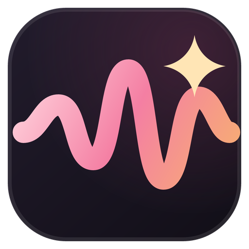
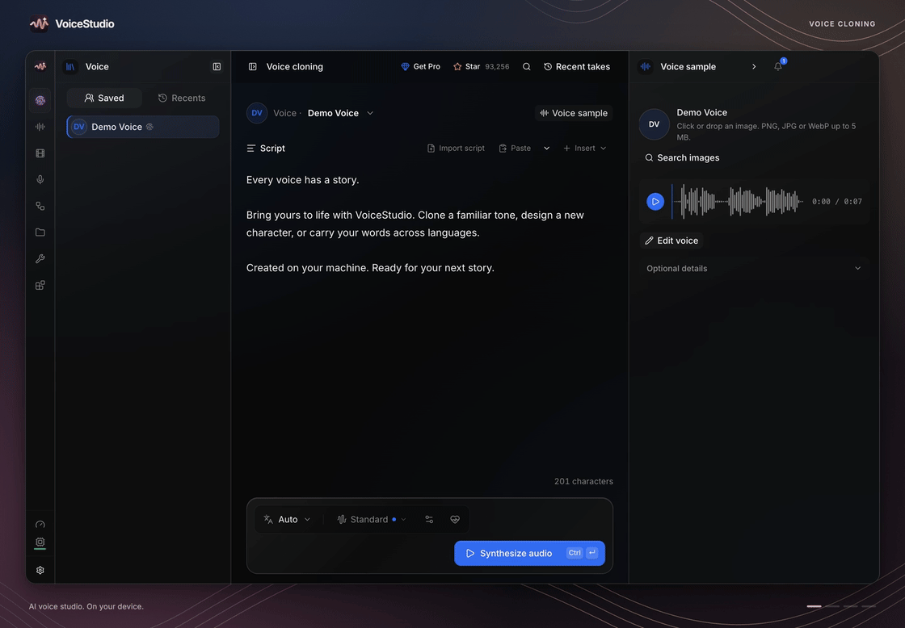
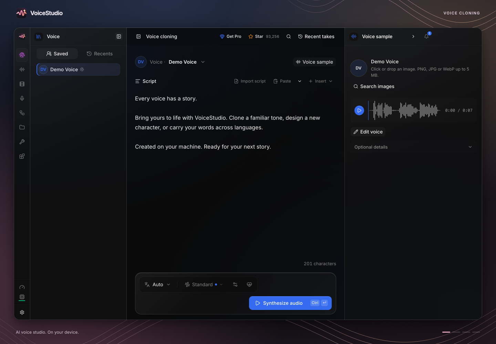
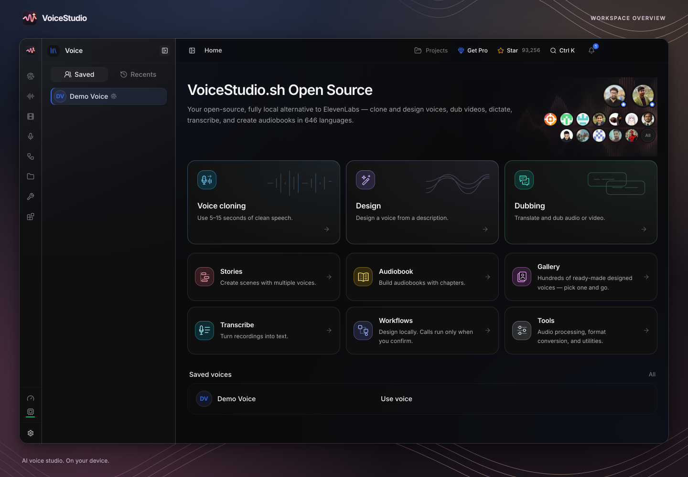
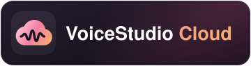

<div align="center">
  <h1><sub></sub> VoiceStudio</h1>
  <p>
    <a href="https://trendshift.io/repositories/28176?utm_source=repository-badge&amp;utm_medium=badge&amp;utm_campaign=badge-repository-28176" target="_blank" rel="noopener noreferrer"></a>
  </p>
  <p>
    <strong>🎉 <a href="https://github.com/debpalash/VoiceStudio/stargazers">100.000 stelle su GitHub — grazie!</a></strong>
  </p>
  <h2>Studio vocale con IA. Sul tuo dispositivo.</h2>
  <h3>Clona e crea voci, doppia, detta, trascrivi e narra in 646 lingue.</h3>
  <p>Funziona su laptop, desktop, server, telefono, tablet e altro ancora</p>
  <p>
    <a href="https://voicestudio.sh/?utm_source=github&utm_medium=readme&utm_campaign=project">Sito web</a> ·
    <a href="https://github.com/debpalash/VoiceStudio/releases/latest">Scarica</a> ·
    <a href="#get-started">Per iniziare</a> ·
    <a href="#documentation">Documentazione</a> ·
    <a href="https://voicestudio.sh/pro?utm_source=github&amp;utm_medium=readme&amp;utm_campaign=project">VoiceStudio Pro</a> ·
    <a href="https://app.voicestudio.sh/?utm_source=github&amp;utm_medium=readme&amp;utm_campaign=project">VoiceStudio Cloud</a>
  </p>
  <!-- README_LANGUAGES_START -->
  <a id="readme-languages"></a>
  <p><sub>
    <a href="../../README.md" lang="en">🇬🇧 English</a> · <a href="README_CN.md" lang="zh-CN">🇨🇳 简体中文</a> · <a href="README_JA.md" lang="ja">🇯🇵 日本語</a> · <a href="README_KO.md" lang="ko">🇰🇷 한국어</a> · <a href="README_RU.md" lang="ru">🇷🇺 Русский</a> · <a href="README_AR.md" lang="ar">🇸🇦 العربية</a> · <a href="README_DE.md" lang="de">🇩🇪 Deutsch</a> · <a href="README_ES.md" lang="es">🇪🇸 Español</a> · <a href="README_FR.md" lang="fr">🇫🇷 Français</a> · <a href="README_HI.md" lang="hi">🇮🇳 हिन्दी</a><br />
    <a href="README_ID.md" lang="id">🇮🇩 Bahasa Indonesia</a> · <strong lang="it">🇮🇹 Italiano</strong> · <a href="README_NL.md" lang="nl">🇳🇱 Nederlands</a> · <a href="README_PL.md" lang="pl">🇵🇱 Polski</a> · <a href="README_PT.md" lang="pt">🇵🇹 Português</a> · <a href="README_TH.md" lang="th">🇹🇭 ไทย</a> · <a href="README_TR.md" lang="tr">🇹🇷 Türkçe</a> · <a href="README_TW.md" lang="zh-TW">🇹🇼 繁體中文</a> · <a href="README_UK.md" lang="uk">🇺🇦 Українська</a> · <a href="README_VI.md" lang="vi">🇻🇳 Tiếng Việt</a>
  </sub></p>
  <!-- README_LANGUAGES_END -->

  <p>
    <a href="https://github.com/debpalash/VoiceStudio/actions/workflows/ci.yml"></a>
    <a href="https://github.com/debpalash/VoiceStudio/releases/latest"></a>
    <a href="../../LICENSE"></a>
    <a href="https://supermetry.com"></a>
    <a href="https://discord.gg/bzQavDfVV9"></a>
  </p>
  <p>
    <sub>Sponsor strategici</sub>      <a href="https://github.com/debpalash/OpenGTM?utm_source=voicestudio&utm_medium=sponsor&utm_campaign=strategic-sponsor&utm_content=readme-logo"><picture><source media="(prefers-color-scheme: dark)" srcset="../../docs/sponsors/opengtm-dark.svg" /></picture></a>
    <a href="https://github.com/debpalash/Opal?utm_source=voicestudio&utm_medium=sponsor&utm_campaign=strategic-sponsor&utm_content=readme-logo"><picture><source media="(prefers-color-scheme: dark)" srcset="../../docs/sponsors/opal-dark.svg" /></picture></a>
    <a href="https://github.com/velixio/supermetry?utm_source=voicestudio&utm_medium=sponsor&utm_campaign=strategic-sponsor&utm_content=readme-logo"><picture><source media="(prefers-color-scheme: dark)" srcset="../../docs/sponsors/supermetry-dark.svg" /></picture></a>
      ·   <sub>Sponsor speciale</sub> 
    <a href="https://spicrawl.com?utm_source=voicestudio&amp;utm_medium=github_readme&amp;utm_campaign=special_sponsor&amp;utm_content=logo"><picture><source media="(prefers-color-scheme: dark)" srcset="../../docs/sponsors/spicrawl-dark.svg" /></picture></a>
  </p>
</div>

<p align="center">
  <a href="../../docs/media/electron/voicestudio.mp4">
    <picture>
      <source media="(prefers-reduced-motion: reduce) and (max-width: 768px)" srcset="../../docs/media/electron/voice-cloning.webp" />
      <source media="(prefers-reduced-motion: reduce)" srcset="../../docs/media/electron/voice-cloning.png" />
      
    </picture>
  </a><br />
  <sub>Area di lavoro demo · Tema scuro predefinito · <a href="../../docs/media/electron/voicestudio.mp4">Guarda il tour in HD</a></sub>
</p>

<p align="center">
  <a href="https://github.com/debpalash/VoiceStudio/releases/latest"></a>
  <a href="#get-started"></a>
  <a href="https://voicestudio.sh/pro?utm_source=github&amp;utm_medium=readme&amp;utm_campaign=project&amp;utm_content=hero-badge"></a>
  <a href="https://app.voicestudio.sh/?utm_source=github&amp;utm_medium=readme&amp;utm_campaign=project&amp;utm_content=hero-badge"></a>
</p>

<a id="what-you-can-do"></a>

## Cosa puoi fare

<table>
  <tr>
    <td width="50%" valign="top">
      <a href="../../docs/media/electron/voice-cloning.png"></a><br />
      <strong><a href="../../docs/audio-quality.md">Clonazione vocale</a></strong><br />
Trasforma una registrazione di riferimento pulita in un discorso con una voce familiare.
    </td>
    <td width="50%" valign="top">
      <a href="../../docs/media/electron/dubbing.png"></a><br />
      <strong><a href="../../docs/electron-dubbing.md">Doppiaggio video</a></strong><br />
Traduci e doppia video con parlato sincronizzato all'originale.
    </td>
  </tr>
  <tr>
    <td width="50%" valign="top">
      <a href="../../docs/media/electron/voice-design.png"></a><br />
      <strong><a href="../../docs/electron-voice-design.md">Progettazione della voce</a></strong><br />
Descrivi una voce in parole e generala.
    </td>
    <td width="50%" valign="top">
      <a href="../../docs/media/electron/models.png"></a><br />
      <strong><a href="../../docs/downloading-models.md">Modelli locali</a></strong><br />
Scegli i tuoi motori e scarica solo i modelli che ti servono.
    </td>
  </tr>
</table>

<details>
<summary><strong>Altri screenshot</strong></summary>

<table>
  <tr>
    <td width="50%"><a href="../../docs/media/electron/overview.png"></a><br /><strong>Panoramica dell'area di lavoro</strong></td>
    <td width="50%"><a href="../../docs/media/electron/model-packs.png"></a><br /><strong>Confezioni di modelli</strong></td>
  </tr>
</table>

</details>

- **Dettatura e trascrizione**: widget di dettatura mobile e trascrizione locale
- **Narra e raggruppa**: storie, audiolibri e lavori in coda
- **Connetti e automatizza**: API locale, MCP, ricette riutilizzabili e cartelle esaminate

Inizia con **VoiceStudio** (predefinito, basato su k2-fsa/OmniVoice) o scegli tra decine di altri motori nel Gestore modelli. Consulta il [catalogo delle funzionalità e del motore](../../docs/feature-catalog.md).

<p align="center"><a href="https://discord.gg/bzQavDfVV9"></a></p>

## Pro e Cloud

Tutto quanto sopra è gratuito, funziona sul tuo hardware e non richiede un account. Pro e Cloud sono facoltativi.

<table>
  <tr>
    <td width="50%" valign="top">
      <a href="https://voicestudio.sh/pro?utm_source=github&amp;utm_medium=readme&amp;utm_campaign=project&amp;utm_content=readme-section"></a>&nbsp;&nbsp;<strong><a href="https://voicestudio.sh/pro?utm_source=github&amp;utm_medium=readme&amp;utm_campaign=project&amp;utm_content=readme-section">VoiceStudio Pro</a></strong><br /><br />
      Per lavori retribuiti per i clienti su più di un computer.
      <ul>
        <li>Una licenza commerciale per il lavoro con i clienti, inviata via e-mail</li>
        <li>Un utente su un massimo di 3 dispositivi contemporaneamente</li>
        <li>Invia i lavori alle altre GPU mentre i progetti restano in locale</li>
        <li>Nuove funzioni e correzioni in anteprima</li>
      </ul>
      <sub>Build a codice chiuso, account richiesto, rimborso completo entro 7 giorni. L’app AGPL-3.0 resta gratuita, anche per l’uso commerciale secondo i suoi termini.</sub><br /><br />
      <strong><a href="https://voicestudio.sh/pro?utm_source=github&amp;utm_medium=readme&amp;utm_campaign=project&amp;utm_content=readme-section">Vedi i piani Pro →</a></strong>
    </td>
    <td width="50%" valign="top">
      <a href="https://app.voicestudio.sh/?utm_source=github&amp;utm_medium=readme&amp;utm_campaign=project&amp;utm_content=readme-section"></a>&nbsp;&nbsp;<strong><a href="https://app.voicestudio.sh/?utm_source=github&amp;utm_medium=readme&amp;utm_campaign=project&amp;utm_content=readme-section">VoiceStudio Cloud</a></strong><br /><br />
      Un’API ospitata per voce e doppiaggio, in arrivo. Nessuna GPU necessaria.
      <ul>
        <li>Sintesi vocale, design della voce e clonazione vocale con consenso</li>
        <li>Doppiaggio, trascrizione e audiolibri</li>
        <li>Utilizzo e crediti per giorno o progetto</li>
        <li>Lavori lunghi che procedono da soli</li>
      </ul>
      <sub>Non ancora disponibile: iscriviti all’accesso anticipato per ricevere crediti di utilizzo gratuiti. L’app desktop resta gratuita e locale.</sub><br /><br />
      <strong><a href="https://app.voicestudio.sh/?utm_source=github&amp;utm_medium=readme&amp;utm_campaign=project&amp;utm_content=readme-section">Partecipa all’accesso anticipato a Cloud →</a></strong>
    </td>
  </tr>
</table>

<a id="platforms"></a>

## Piattaforme

Scegli il tuo sistema, quindi espandi un metodo di installazione.

I motori GGUF nativi supportano anche l’accelerazione Vulkan specifica del motore su GPU AMD, Intel e NVIDIA ([OmniVoice](../../docs/engines/omnivoice-gguf.md#vulkan-acceleration), [CosyVoice](../../docs/engines/cosyvoice-gguf.md)). OmniVoice GGUF seleziona automaticamente GPU e dimensione del modello su Windows e Linux. Se una verifica nascosta si blocca, il rilevamento Vulkan riprova con un riepilogo nativo; le build desktop per Windows e Linux falliscono invece di essere distribuite silenziosamente senza il modulo Vulkan.

<a id="install-macos"></a>

<details>
<summary> <strong>macOS</strong> · Homebrew · DMG · programma di installazione</summary>

<blockquote>

**Stabile · Apple Silicon**<br />macOS 13.3+ · Apple Silicon: motori locali con Metal (MPS).

<a href="https://github.com/debpalash/homebrew-tap"></a>

```sh
brew tap debpalash/tap
brew trust --cask debpalash/tap/voicestudio
brew install --cask debpalash/tap/voicestudio
```

<details>
<summary>DMG</summary>

Scarica DMG per il tuo Mac, aprilo e trascina VoiceStudio in Applicazioni.

[Scarica](https://github.com/debpalash/VoiceStudio/releases/latest) · [Guida](../../docs/install/macos.md)

</details>

<details>
<summary>Programma di installazione con un solo comando</summary>

```sh
curl -fsSL https://voicestudio.sh/install | sh
```

</details>

<details>
<summary>Intel Mac · backend remoto · Limitato</summary>

L'interfaccia utente dell'app funziona su Intel; collegalo al backend VoiceStudio su un altro computer.

[Guida](../../docs/install/macos.md)

</details>

> [!NOTE]
> Su macOS, «VoiceStudio è danneggiato e non può essere aperto» significa che Gatekeeper ha bloccato l’app, non che il file scaricato sia danneggiato. [Risolvere il blocco di Gatekeeper](../../docs/install/macos.md#gatekeeper-quarantine).

</blockquote>

</details>

<a id="install-windows"></a>

<details>
<summary> <strong>Windows</strong> · PowerShell · EXE</summary>

<blockquote>

**Stabile · x64**<br />Windows 10/11 x64 · NVIDIA CUDA · AMD ROCm (opt-in) · CPU.

```powershell
irm https://voicestudio.sh/install.ps1 | iex
```

[Scarica il programma di installazione di Windows](https://github.com/debpalash/VoiceStudio/releases/latest) · [Guida](../../docs/install/windows.md) · [AMD ROCm](../../docs/install/windows-rocm.md)

<details>
<summary>Windows su ARM · sperimentale</summary>

Interfaccia utente nativa dell'app; il backend Python x64 viene eseguito in emulazione sulla CPU.

[Scarica](https://github.com/debpalash/VoiceStudio/releases/latest) · [Guida](../../docs/install/windows.md)

</details>

</blockquote>

</details>

<a id="install-linux"></a>

<details open>
<summary> <strong>Linux</strong> · AUR · Snap · DEB · AppImage · Nix</summary>

<blockquote>

**Stabile · x64**<br />Linux x64 · NVIDIA CUDA · CPU · Vulkan per motori GGUF supportati.

<details>
<summary>Programma di installazione con un solo comando</summary>

```sh
curl -fsSL https://voicestudio.sh/install | sh
```

</details>

<details>
<summary>Arch / Manjaro / EndeavourOS · AUR</summary>

<a href="https://aur.archlinux.org/packages/voicestudio-bin"></a>

```sh
yay -S voicestudio-bin
```

Disponibile anche tramite `paru -S voicestudio-bin`.

[Fonti di sviluppo](https://aur.archlinux.org/packages/voicestudio-git) · `yay -S voicestudio-git`

<details>
<summary>Compila da AUR e installa con pacman</summary>

```sh
sudo pacman -S --needed base-devel git
git clone https://aur.archlinux.org/voicestudio-bin.git
cd voicestudio-bin
makepkg -s
sudo pacman -U ./voicestudio-bin-*.pkg.tar.zst
```

</details>

</details>

<details>
<summary>Ubuntu / Debian / Linux Mint · DEB</summary>

Scarica `.deb` nella cartella corrente, quindi installalo:

[Scarica](https://github.com/debpalash/VoiceStudio/releases/latest)

```sh
sudo apt install ./VoiceStudio-*-linux-x64.deb
```

</details>

<details>
<summary>Snap · Ubuntu, Fedora, openSUSE e altro ancora</summary>

<a href="https://snapcraft.io/voicestudio"></a>

Con [snapd installato](https://snapcraft.io/docs/installing-snapd):

```sh
sudo snap install voicestudio
```

Per abilitare l'accesso al microfono:

```sh
sudo snap connect voicestudio:audio-record
```

</details>

<details>
<summary>Qualsiasi distribuzione Linux · AppImage</summary>

Scarica AppImage nella cartella corrente, quindi avviala:

[Scarica](https://github.com/debpalash/VoiceStudio/releases/latest)

```sh
chmod +x VoiceStudio-*-linux-x64.AppImage
./VoiceStudio-*-linux-x64.AppImage
```

</details>

<details>
<summary>Nix / NixOS · ambiente sorgente</summary>

Accedi all'ambiente di sviluppo FHS del repository, quindi esegui dal sorgente:

```sh
git clone https://github.com/debpalash/VoiceStudio.git
cd VoiceStudio
nix develop .#fhs
bun run dev
```

[Guida](../../docs/install/nix.md)

</details>

[Guida](../../docs/install/linux.md)

</blockquote>

</details>

<a id="install-docker"></a>

<details>
<summary> <strong>Docker</strong> · GHCR · Docker Hub</summary>

<blockquote>

Immagini container stabili · CPU · NVIDIA CUDA · AMD ROCm.

<a href="https://github.com/debpalash/VoiceStudio/pkgs/container/voicestudio"></a>

**Esegui localmente sulla CPU (Bash)**

```sh
export OMNIVOICE_API_KEY="$(openssl rand -hex 32)"
docker run -d --name omnivoice \
  -p 127.0.0.1:3900:3900 \
  -e OMNIVOICE_API_KEY \
  -e OMNIVOICE_DATA_DIR=/app/omnivoice_data \
  -v omnivoice-data:/app/omnivoice_data \
  ghcr.io/debpalash/voicestudio:stable
printf 'API key: %s\n' "$OMNIVOICE_API_KEY"
```

Apri http://localhost:3900 e utilizza la chiave API stampata di seguito.

[Istruzioni per NVIDIA, AMD ROCm e Compose](../../docs/install/docker.md)

[Mirror dell'hub Docker](https://hub.docker.com/r/palashdeb/omnivoice-studio): `palashdeb/omnivoice-studio:stable`

</blockquote>

</details>

<a id="install-android"></a>

<details>
<summary> <strong>Android</strong> · APK · Obtainium · Repository F-Droid</summary>

<blockquote>

Android 10+ · Anteprima · Sul dispositivo, offline dopo il download del modello.

[Scarica APK](https://github.com/debpalash/VoiceStudio/releases/latest) · [Guida](../../docs/mobile.md#install)

<details>
<summary>F-Droid · Archivio VoiceStudio</summary>

Aggiungi questo repository in un client compatibile con F-Droid; verificare l'impronta digitale nella guida.

```text
https://debpalash.github.io/VoiceStudio/fdroid/repo
```

[Guida](../../store/fdroid/README.md)

</details>

<details>
<summary>Obtainium · Rilasci GitHub</summary>

Aggiungi questa fonte in Obtainium o importa la configurazione fornita.

```text
https://github.com/debpalash/VoiceStudio
```

[Importa configurazione](https://debpalash.github.io/VoiceStudio/obtainium.json)

</details>

<details>
<summary>Installa tramite USB con adb</summary>

```sh
adb install -r VoiceStudio-*-android.apk
```

</details>

</blockquote>

</details>

<a id="install-ios"></a>

<details>
<summary> <strong>iPhone / iPad</strong> · IPA · caricamento laterale</summary>

<blockquote>

iOS/iPadOS 17+ · Anteprima · Sul dispositivo, offline dopo il download del modello.

Scarica l'IPA e segui le istruzioni per la firma e il sideload.

[Scarica](https://github.com/debpalash/VoiceStudio/releases/latest) · [Guida](../../docs/mobile.md#install)

</blockquote>

</details>

I programmi di installazione per desktop e telefono si trovano sull'[ultima versione](https://github.com/debpalash/VoiceStudio/releases/latest); Le immagini Docker provengono da GHCR. Nessuna GPU? L'app è completamente utilizzabile sulla CPU, solo più lenta. I motori GGUF nativi possono anche utilizzare Vulkan su GPU AMD, Intel e NVIDIA; GGUF OmniVoice sceglie automaticamente la GPU e le dimensioni del modello su Windows e Linux ([OmniVoice](../../docs/engines/omnivoice-gguf.md#vulkan-acceleration), [CosyVoice](../../docs/engines/cosyvoice-gguf.md)). Velocità per motore e hardware: [prestazioni](../../docs/performance.md).


<a id="get-started"></a>

## Per iniziare

Installa utilizzando le opzioni sopra. Quindi apri **Clonazione vocale**, scegli una voce o aggiungi una registrazione di riferimento pulita, digita il testo e genera. L'app chiede prima di scaricare qualsiasi modello.

<details>
<summary><strong>Altre opzioni di installazione</strong>: una versione specifica, corrente principale, disinstalla, dal sorgente, con un agente di codifica</summary>

```sh
curl -fsSL https://voicestudio.sh/install | sh -s -- --version X.Y.Z   # a specific release
curl -fsSL https://voicestudio.sh/install | sh -s -- --main            # build current main
curl -fsSL https://voicestudio.sh/install | sh -s -- --uninstall       # remove the app, keep your data
```

Se `voicestudio.sh` non è raggiungibile, esegui lo script direttamente dal repository: `curl -fsSL https://raw.githubusercontent.com/debpalash/VoiceStudio/main/scripts/install.sh | sh`. Prerequisiti e comportamento: [guida all'installazione](../../docs/install/script.md).

**Dalla fonte**

```bash
git clone https://github.com/debpalash/VoiceStudio.git
cd VoiceStudio
bun run dev
```

`bun run dev` installa le dipendenze JavaScript e, quando si utilizza un backend locale supportato, le dipendenze Python prima di avviare Electron. Esegui direttamente `bun run setup:api` quando devi solo ricostruire l'ambiente Python.

Vedere [Configurazione dell'elettrone](../../electron/README.md).

**Con un agente di codifica** (Claude Code, Codex, Cursor, …), incolla:

```text
Install the VoiceStudio app on this device and verify it works, following
https://github.com/debpalash/VoiceStudio/blob/main/docs/install/agent.md
```

Aggiornamento dalla 0.5.3 o precedente (l'app Tauri)? [Installa la nuova app separatamente](../../docs/electron-migration.md).

</details>

<a id="documentation"></a>

## Documentazione

[Tutte le guide](../../docs/README.md)

| Bisogno | Inizia qui |
|---|---|
| Aiuto per la configurazione | [Risoluzione dei problemi](../../docs/install/troubleshooting.md) · [Download dei modelli](../../docs/downloading-models.md) |
| Guide | [Doppiaggio con più parlanti](../../docs/dubbing/multi-speaker-guide.md) · [Voce espressiva](../../docs/expressive-speech.md) · [Esportare i doppiaggi](../../docs/dubbing/export.md) |
| Modelli e qualità | [Guide motore](../../docs/engines/README.md) · [whisper.cpp ASR](../../docs/engines/whisper-cpp.md) · [Benchmarks](../../docs/benchmarks.md) |
| Integrazioni | [API locale](../../docs/speech-platform.md) · [MCP](../../docs/mcp.md) · [Esempi](../../examples/README.md) |
| App del telefono | [iOS e Android](../../docs/mobile.md) |
| Sviluppo | [Contribuire](../../.github/CONTRIBUTING.md) ([firmare il CLA](../../.github/CONTRIBUTING.md#contribution-licensing) prima del tuo primo PR) · [Changelog](../../CHANGELOG.md) |

Competenze per gli agenti: `npx skills add debpalash/VoiceStudio` (**voicestudio** per l’audio, **voicestudio-maintainer** per il repository).

<a id="sponsors"></a>

## Sponsor

VoiceStudio è gratuito e non dipende da un servizio cloud a pagamento. Gli sponsor permettono di continuare lo sviluppo e le pubblicazioni, finanziando il lavoro dei manutentori, l’hardware di test, la firma del codice e l’infrastruttura di rilascio.

<p>
    <a href="https://github.com/debpalash/OpenGTM?utm_source=voicestudio&utm_medium=sponsor&utm_campaign=strategic-sponsor&utm_content=readme-logo"><picture><source media="(prefers-color-scheme: dark)" srcset="../../docs/sponsors/opengtm-dark.svg" /></picture></a>
    <a href="https://github.com/debpalash/Opal?utm_source=voicestudio&utm_medium=sponsor&utm_campaign=strategic-sponsor&utm_content=readme-logo"><picture><source media="(prefers-color-scheme: dark)" srcset="../../docs/sponsors/opal-dark.svg" /></picture></a>
    <a href="https://github.com/velixio/supermetry?utm_source=voicestudio&utm_medium=sponsor&utm_campaign=strategic-sponsor&utm_content=readme-logo"><picture><source media="(prefers-color-scheme: dark)" srcset="../../docs/sponsors/supermetry-dark.svg" /></picture></a>
</p>

Per richieste di sponsorizzazione, contattare [sponsor@voicestudio.sh](mailto:sponsor@voicestudio.sh).

<a href="https://github.com/sponsors/debpalash"></a>
[Ko-fi](https://ko-fi.com/debpalash) · [PayPal](https://paypal.me/palashCoder) · [Livelli e vantaggi](../../SPONSORS.md) · [Inserisci il tuo logo nell'elenco](https://github.com/debpalash/VoiceStudio/issues/new?template=sponsor.yml)

<a id="other-projects"></a>

## Altri progetti

Altri strumenti open source dalle persone che sviluppano VoiceStudio.

- **[OpenGTM](https://opengtm.palash.dev/?utm_source=voicestudio&utm_medium=sponsor&utm_campaign=strategic-sponsor&utm_content=related-projects)** — Trova e arricchisci aziende e persone in uno spazio di lavoro go-to-market self-hosted. [Fonte](https://github.com/debpalash/OpenGTM).
- **[Opal](https://opal.palash.dev/?utm_source=voicestudio&utm_medium=sponsor&utm_campaign=strategic-sponsor&utm_content=related-projects)** — Guarda, riproduci in streaming e sfoglia i tuoi contenuti multimediali in un player nativo e open source. [Fonte](https://github.com/debpalash/Opal).
- **[Supermetry](https://supermetry.com/?utm_source=voicestudio&utm_medium=sponsor&utm_campaign=strategic-sponsor&utm_content=related-projects)** — Comprendi i tuoi siti web e i tuoi prodotti con analisi self-hosted e senza cookie. [Fonte](https://github.com/velixio/supermetry).

Altri progetti: [debpalash](https://github.com/debpalash?tab=repositories) · [velixio](https://github.com/velixio?tab=repositories)

<a id="team"></a>

## Squadra

<a id="core-team"></a>

### Squadra centrale

<table>
<tr>
<td align="center" width="200"><a href="https://github.com/debpalash"></a><br><b>Palash Debnath</b><br><sub>Creatore e team principale</sub><br><sub><a href="https://palash.dev">palash.dev</a> · <a href="https://github.com/debpalash">GitHub</a> · <a href="https://x.com/idebpalash">X</a></sub></td>
<td align="center" width="200"><a href="https://github.com/velixio"></a><br><b>Shimul Debnath</b><br><sub>Squadra centrale</sub><br><sub><a href="https://shimul.me">shimul.me</a> · <a href="https://github.com/velixio">GitHub</a> · <a href="https://x.com/shimuldn">X</a></sub></td>
</tr>
</table>

<a id="contributors"></a>

### Collaboratori

<a href="https://github.com/kevin9327"></a> <a href="https://github.com/jaketame"></a> <a href="https://github.com/psiberfunk"></a> <a href="https://github.com/rudycelekli"></a> <a href="https://github.com/paoloantinori"></a> <a href="https://github.com/Chang-Jin-Lee"></a> <a href="https://github.com/swadhinbiswas"></a> <a href="https://github.com/BichengWang"></a> <a href="https://github.com/nirmalchatur"></a> <a href="https://github.com/Shivendra-Coherent"></a> <a href="https://github.com/marreiradigital"></a> <a href="https://github.com/nvtoan0201-swe"></a>

Grazie a tutti coloro che inviano codice, report, traduzioni e idee. [Tutti i contributori](https://github.com/debpalash/VoiceStudio/graphs/contributors) · [Contribuisci](../../.github/CONTRIBUTING.md)

<a id="license--responsible-use"></a>

## Licenza e uso responsabile

[AGPL-3.0](../../LICENSE) copre l'app, incluso l'uso commerciale secondo i suoi termini. I pesi dei modelli, le voci e l'output generato hanno le proprie licenze, che il Gestore del modello mostra per ciascun modello ([inventario](../../docs/licensing/model-inventory.md)). Clona una voce solo con il permesso del suo proprietario. Dettagli: [LICENSE-NOTICE.md](../../LICENSE-NOTICE.md).

<a id="community-tutorials"></a>

## Tutorial della comunità

<p align="center">
  <a href="https://www.youtube.com/watch?v=I-u-A-oisIU&amp;utm_source=github&amp;utm_medium=readme&amp;utm_campaign=community_tutorials"></a>
  <a href="https://www.youtube.com/watch?v=hsLRbXLBP4U&amp;utm_source=github&amp;utm_medium=readme&amp;utm_campaign=community_tutorials"></a>
  <a href="https://www.youtube.com/watch?v=2KemGhEI0Ck&amp;utm_source=github&amp;utm_medium=readme&amp;utm_campaign=community_tutorials"></a><br />
  <sub>Nafay 3D · Samuel Gregory · kilObit</sub>
</p>

<p align="center"><a href="https://discord.gg/bzQavDfVV9"></a></p>
